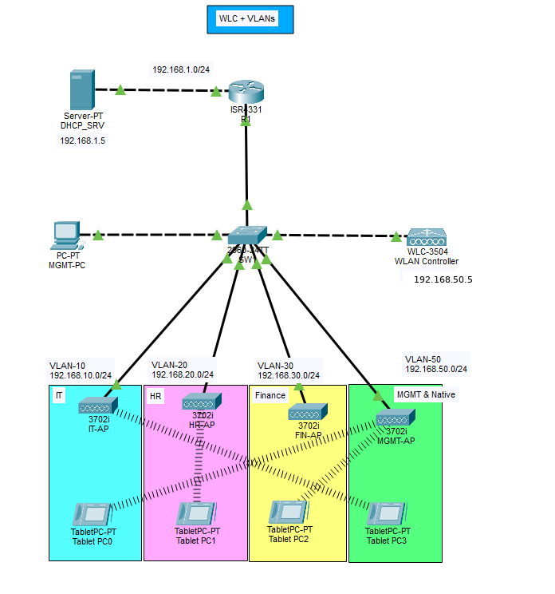

# Cisco WLC, FlexConnect, and Wireless VLAN Segmentation Lab



## Overview

This Cisco Packet Tracer lab demonstrates centralized wireless management with a Cisco 3504 Wireless LAN Controller, four lightweight access points, four WLANs, VLAN segmentation, FlexConnect local switching, WPA2-PSK security, router-on-a-stick, and centralized DHCP relay.

Wireless users are separated into IT, HR, Finance, and Management networks. Each SSID maps to its corresponding VLAN, and R1 provides the default gateway and inter-VLAN routing. DHCP is hosted on a dedicated server in `192.168.1.0/24`; R1 relays client broadcasts to that server using `ip helper-address`.

## Skills demonstrated

- Cisco 3504 WLC initial configuration
- Lightweight AP and controller architecture
- WLC management and dynamic interfaces
- WLAN/SSID creation and interface mapping
- WPA2-PSK with AES
- FlexConnect local switching
- VLAN and native VLAN design
- 802.1Q trunk configuration and VLAN pruning
- Router-on-a-stick
- DHCP relay and centralized DHCP scopes
- Wireless client segmentation
- Inter-VLAN routing and connectivity verification

## Logical design

| Component | Role |
|---|---|
| WLC-3504 | Centralized WLAN configuration and AP management |
| Four 3702i APs | IT, HR, Finance, and Management wireless access |
| SW1 | VLAN and trunk transport |
| R1 | VLAN gateways, inter-VLAN routing, and DHCP relay |
| DHCP_SRV | Centralized DHCP server at `192.168.1.5` |
| MGMT-PC | Wired management endpoint in VLAN 50 |

## Addressing and WLAN mapping

| VLAN | Department | Subnet | Gateway | WLC interface | SSID |
|---:|---|---|---|---|---|
| 10 | IT | `192.168.10.0/24` | `192.168.10.1` | `192.168.10.7` | `IT` |
| 20 | HR | `192.168.20.0/24` | `192.168.20.1` | `192.168.20.7` | `HR` |
| 30 | Finance | `192.168.30.0/24` | `192.168.30.1` | `192.168.30.7` | `FIN` |
| 50 | Management/native | `192.168.50.0/24` | `192.168.50.1` | WLC management `192.168.50.5` | `MGMT` |
| — | Server network | `192.168.1.0/24` | `192.168.1.1` | — | — |

## Key configuration

### Router-on-a-stick and DHCP relay

```cisco
interface GigabitEthernet0/0/1.10
 encapsulation dot1Q 10
 ip address 192.168.10.1 255.255.255.0
 ip helper-address 192.168.1.5

interface GigabitEthernet0/0/1.20
 encapsulation dot1Q 20
 ip address 192.168.20.1 255.255.255.0
 ip helper-address 192.168.1.5

interface GigabitEthernet0/0/1.30
 encapsulation dot1Q 30
 ip address 192.168.30.1 255.255.255.0
 ip helper-address 192.168.1.5

interface GigabitEthernet0/0/1.50
 encapsulation dot1Q 50 native
 ip address 192.168.50.1 255.255.255.0
 ip helper-address 192.168.1.5
```

### Trunk configuration

```cisco
interface FastEthernet0/x
 switchport trunk native vlan 50
 switchport trunk allowed vlan 10,20,30,50
 switchport mode trunk
```

### Management PC access port

```cisco
interface FastEthernet0/3
 description Management-PC
 switchport access vlan 50
 switchport mode access
 spanning-tree portfast
```

## Wireless configuration

The WLC uses:

- Management interface: `192.168.50.5/24`
- Management VLAN: 50
- Default gateway: `192.168.50.1`
- Virtual interface: `192.0.2.1`
- Dynamic interfaces for VLANs 10, 20, and 30
- WPA2-PSK with AES
- FlexConnect local switching

The detailed settings are documented in [configurations/WLC-settings.md](configurations/WLC-settings.md).

## DHCP design

The DHCP server uses four scopes beginning at `.11`, reserving low addresses for gateways and infrastructure:

| Pool | Start address | Gateway | DNS |
|---|---|---|---|
| IT-Pool | `192.168.10.11` | `192.168.10.1` | `8.8.8.8` |
| HR-Pool | `192.168.20.11` | `192.168.20.1` | `8.8.8.8` |
| FIN-Pool | `192.168.30.11` | `192.168.30.1` | `8.8.8.8` |
| MGMT-Pool | `192.168.50.11` | `192.168.50.1` | `8.8.8.8` |

## Verification results

- The management PC reached R1 at `192.168.50.1` with 0% loss.
- The management PC reached the WLC at `192.168.50.5` with 0% loss.
- Wireless clients received addresses in their intended VLANs.
- A VLAN 50 wireless client reached a VLAN 10 wireless client through R1.
- Trunks carried only VLANs `10,20,30,50` with VLAN 50 as native.
- Fa0/3 operated as a static access port in VLAN 50 and did not appear in the trunk list.

See [verification/verification-checklist.md](verification/verification-checklist.md) and the `screenshots/` directory.

## Repository structure

```text
.
├── README.md
├── LICENSE
├── configurations/
│   ├── R1.txt
│   ├── SW1.txt
│   ├── WLC-settings.md
│   └── DHCP-scopes.md
├── packet-tracer/
├── screenshots/
├── topology/
├── troubleshooting/
└── verification/
```

## Learning outcomes

This lab connected wireless and wired networking concepts. A functioning SSID alone is not sufficient: the WLC interface, WLAN mapping, AP switching mode, switch trunk, router subinterface, DHCP relay, and return path must all agree. Restricting trunk VLANs and using a dedicated management access port also produced a cleaner and more intentional Layer 2 design.

## Future improvements

Possible future additions after studying the relevant topics include 802.1X/RADIUS authentication, rogue AP detection, DHCP snooping, ACL-based WLAN policy, redundant WLC design, and expanded wireless monitoring.

## Disclaimer

This is an educational CCNA lab built in Cisco Packet Tracer. Passwords and WPA2 keys are intentionally omitted. The configuration is not intended as a production template.
